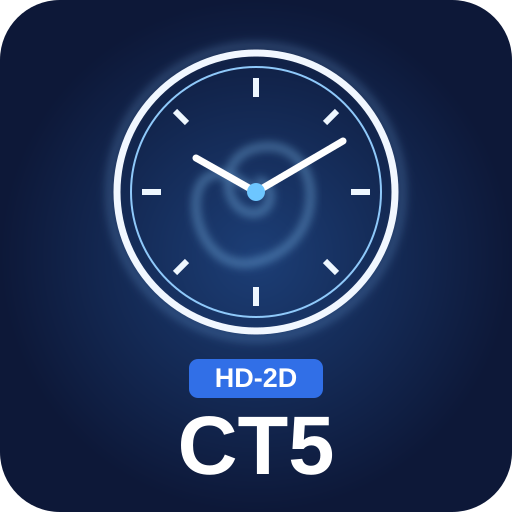

<div align="center">



# TRIGGERED CHRONO
### Native Recompilation · HD-2D Ambitions · Community-Driven Development

**An unofficial Chrono Trigger native-port project built on [ct-recomp](https://github.com/ThisIsAkill/ct-recomp).**

[](LICENSE)
[](ROADMAP.md)
[](https://github.com/savageforengland-hue/Triggered-Chrono-RecompHD2D/issues)
[](https://github.com/savageforengland-hue/Triggered-Chrono-RecompHD2D/stargazers)

[**Getting started**](#getting-started) · [**Features**](#project-highlights) · [**Roadmap**](ROADMAP.md) · [**Documentation**](#documentation) · [**Build**](#build)

</div>

---

> [!IMPORTANT]
> **Bring your own legally obtained game ROM.** No Chrono Trigger ROM, copyrighted game assets, music or artwork are distributed with this repository. This fan project is not affiliated with or endorsed by the game's rights holders.

## Overview

Triggered Chrono explores a native PC experience for **Chrono Trigger (SNES, US 1.0)** through static recompilation, with optional HD-2D-style presentation and an extensible engine. The project combines the foundations of [ct-recomp](https://github.com/ThisIsAkill/ct-recomp) with work on modern rendering, usability and mod-friendly asset workflows.

**Development status:** Work in progress. The existence of a roadmap item does not mean that feature is finished, and this repository should not be presented as a completed HD-2D remaster.

## Project highlights

| Area | What the repository covers |
| :--- | :--- |
| **Native recompilation** | 65816-to-C translation and a native runtime, with interpreter fallback |
| **HD-2D direction** | Optional enhanced presentation and external asset-pack workflows |
| **Modern controls** | SDL2 frontend, keyboard and gamepad support |
| **Testing** | ROM-free engine tests, headless boot probes and comparison tooling |
| **Portable foundations** | PC-oriented builds, handheld guidance and future platform goals |
| **Open development** | GPL-3.0-or-later licensing and documented third-party attribution |

## Getting started

**For players:** Start with the [player's guide](docs/USER-GUIDE.md). It covers installation, first launch, controls and troubleshooting.

**For developers:** See [Build](#build) for prerequisites, engine-only compilation and optional ROM-based builds.

**For artists and modders:** Read the [asset-pack documentation](docs/ASSET-PACKS.md) for external graphics and audio replacement workflows. No replacement art or music is bundled.

## Documentation

| Guide | Purpose |
| :--- | :--- |
| [Player's guide](docs/USER-GUIDE.md) | Installation, launch and troubleshooting |
| [Handheld setup](docs/HANDHELD.md) | Steam Deck and other handheld devices |
| [Asset packs](docs/ASSET-PACKS.md) | Custom and user-supplied graphics/audio |
| [Roadmap](ROADMAP.md) | Planned enhancements and development priorities |
| [Progress report](game/ct/PROGRESS.md) | Recompilation metrics and technical progress |
| [Third-party credits](THIRD_PARTY.md) | Dependencies, notices and attribution |

## Development priorities

The [full roadmap](ROADMAP.md) documents proposed graphics, audio, accessibility, platform and quality-of-life improvements. Key directions include HD asset packs, widescreen support, HD text, MSU-1 audio and future console support. **These are goals, not promises of current functionality.**

## Credits and legal notice

This project builds on **ct-recomp by Akhil Moola** and includes other credited open-source components. See [THIRD_PARTY.md](THIRD_PARTY.md) and [REUSE.toml](REUSE.toml) for attribution and license details.

*Chrono Trigger* and its associated intellectual property belong to their respective rights holders. This is an independent, unofficial fan project. You must supply your own legally obtained, compatible ROM.

---

<details>
<summary><strong>Technical reference, licensing and original build documentation</strong></summary>

## License

This project is licensed under the GNU General Public License, version 3 or (at your
option) any later version: see [LICENSE](LICENSE).

It includes code under other, GPL-compatible licenses, which keeps its original notices:
ct-recomp (MIT), the zelda3 SNES core (MIT) and the ares SPC700 core (ISC). The file-by-file
map is in [REUSE.toml](REUSE.toml), the license texts are in [LICENSES/](LICENSES/), and the
details are in [THIRD_PARTY.md](THIRD_PARTY.md).

---

*The rest of this README comes from upstream ct-recomp.*

## ct-recomp

[](https://github.com/ThisIsAkill/ct-recomp/actions/workflows/ci.yml)

Static recompiler for Chrono Trigger (SNES, US 1.0) 65816 code to C, plus a C runtime.
The recompiler and runtime are game-agnostic; everything specific to Chrono
Trigger lives in `game/ct/`.

Planned features after boot (MSU-1, achievements, save states, widescreen and
more) are listed in [ROADMAP.md](ROADMAP.md).

## Progress

<!-- progress:start -->

**87.9% recompiled**: 1990 of 2263 known functions are compiled to C.

- Native at runtime: 98.0% of the instructions in a 1500-frame boot run as compiled C (the rest run in the interpreter).

Updated by `tools/progress.py` with every push; details in [game/ct/PROGRESS.md](game/ct/PROGRESS.md).

<!-- progress:end -->

## Layout

- `recomp/` — the translator (Python): decoder with static M/X tracking, C emitter.
- `runtime/` — CPU, bus, cycle model, interpreter, frame scheduler; the vendored
  PPU/DMA/APU core lives in `third_party/snes/`.
- `frontend/` — SDL2 frontend; `tools/ct_boot.c` — headless boot probe.
- `test/` — engine tests; they run on a synthetic ROM generated at build time.
- `game/ct/` — everything specific to Chrono Trigger: `game.toml` (ROM identity),
  `funcs.toml` / `unresolved.toml` (symbols), extern hooks, game tools, the
  ROM-dependent tests, and `PROGRESS.md`.

## Build

Requirements: CMake 3.20+, a C11 compiler, Python 3.11+, SDL2 (optional, for
`ct_sdl`).

Engine only (no ROM needed; what CI runs):

```
cmake -S . -B build && cmake --build build -j && ctest --test-dir build -LE rom
```

With the game. Supply your own headerless US 1.0 ROM; it is checked against
`game/ct/game.toml` at configure time:

```
export CT_ROM=/path/to/chrono_trigger.sfc   # headerless, 4 MB
cmake -S . -B build && cmake --build build -j && ctest --test-dir build
```

This builds `game/ct` (generated C goes to `build/game/ct/out/`) and two
programs at the top of `build/`. For investigations, a Debug tree builds in
about 30 seconds (runtime at `-Og`, generated code at `-O1`, see `CT_GEN_OPT`):
`cmake -S . -B build-dbg -DCMAKE_BUILD_TYPE=Debug`. The build uses ccache when
it is installed.

```
build/ct_sdl                           # play: window, audio, keyboard/controller
mkdir -p shots && build/ct_boot --frames 1500 --dump shots   # headless: PNGs of what changed
```

`ct_sdl` keys: arrows, Z=B, X=A, A=Y, S=X, Q=L, W=R, Enter=Start, Right Shift=Select;
a game controller works too. Ctrl+Q or closing the window quits.
On a touchscreen an on-screen controller appears when you touch the window
(`--touch` shows it from the start and lets the mouse press it; see
[docs/ANDROID-BUILD.md](docs/ANDROID-BUILD.md#the-touch-controller)).
`ct_sdl --record FILE` saves your pad input as a script; `ct_boot --script FILE
--frames N` replays it exactly (N is on its last line), and `ct_sdl --script
FILE` plays it back in the window. A `reset F` line in a script presses the reset button as
frame F begins. `ct_boot` also takes `--input F1-F2:BUTTONS`
to script the pad, `--wav FILE` for audio, `--hash-log FILE` for per-frame
state hashes (`tools/lockstep.py` compares native and interpreted runs with
them), and `--needed-hw FILE` to report where emulation stops.

Engine-only (`build/ct_sdl_engine`, no game code inside, see
[docs/MODULES.md](docs/MODULES.md)): started without `--module`, it finds your
ROM (`--rom FILE`, then `$CT_ROM`, then the one it used last, else it asks you
to drop the file on its window), checks it against `game/ct/game.toml`, builds
the game module from it into its preferences folder
(`~/.local/share/ct-recomp/ct/`) with a progress screen, about 40 seconds once,
and starts the game. Later runs reuse the module until the ROM or the module
ABI changes. If the build fails, a key press plays in the interpreter instead.

```
build/ct_sdl_engine --hd2d --rom /path/to/chrono_trigger.sfc
build/ct_sdl_engine --hd2d             # later: the ROM and module are remembered
```

`--data-dir DIR` points it at an installed copy of `game/` and `tools/` (default:
this source tree; packagers set `-DCT_ENGINE_DATA_DIR=...`). Before shipping a
package, `tools/check_dist.py PACKAGE --rom ROM` checks it for anything built
from the ROM, inside `.zip`, `.tar` and `.AppImage` files too.

Reference comparison: `tools/ref_compare.py --probe build/ct_boot --mesen PATH
--rom $CT_ROM --frames N [--script FILE]` runs the same input in
[Mesen 2](https://github.com/SourMesen/Mesen2) (used as a tool, headless under
`xvfb-run`, with a private settings folder) and reports the first frame where
WRAM or the picture differs, with the differing WRAM ranges.
`tools/trace_diff.py --probe build/ct_boot --mesen PATH --rom $CT_ROM --from F
--to G [--script FILE]` runs both untraced up to frame F and compares every
instruction of frames F-G (address, clock, X, Y), reporting the first
difference; about a minute for a window 12,000 frames in.
`tools/tas_convert.py MOVIE OUT` turns a TASVideos BizHawk `.bk2` or lsnes
`.lsmv` movie (from power-on) into an input script for both, resets included. Replays of a new
game into Leene Square and into the first battle are in `game/ct/test/replay/`.

The ROM is never committed, and CI never sees it.

Symbol names partly derived from dscotton/ct_disassembly (public domain) and ChronoRET.

## ROM and credits

The project's license is GPL-3.0-or-later; see [License](#license) above. The Chrono Trigger ROM and its
assets are **not included** and remain the property of their copyright
holders — you must supply your own legally obtained ROM via `$CT_ROM`.
Symbol names are credited to dscotton/ct_disassembly (public domain) and
ChronoRET. See `THIRD_PARTY.md` for vendored/adapted third-party code.

</details>
